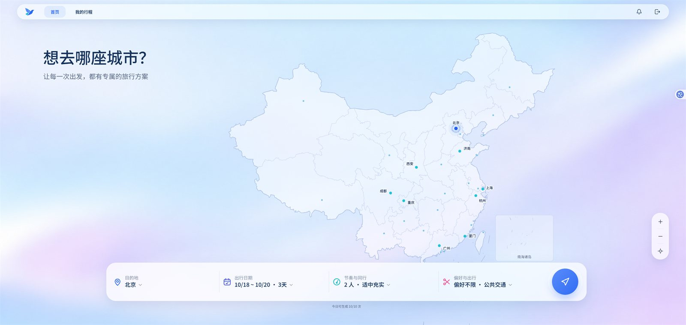
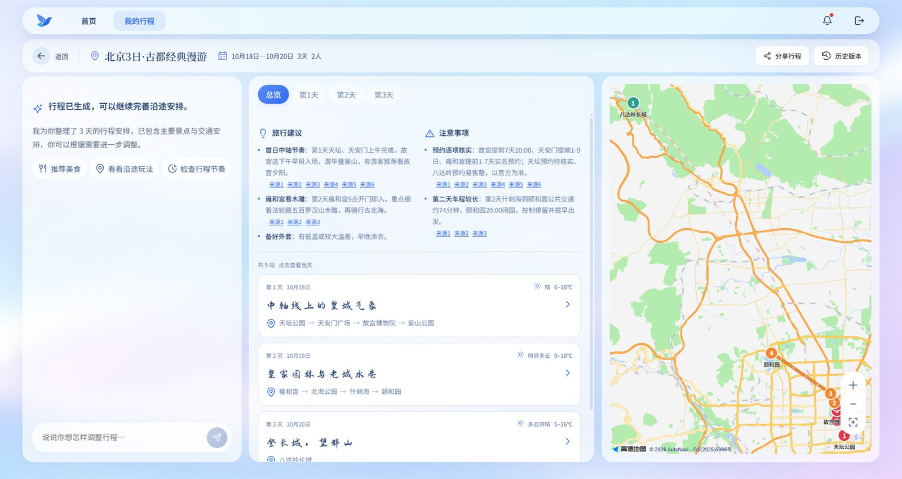

# 织程 TripWeaver

<p>
  <a href="https://sakiiko.com"></a>
  <a href="https://github.com/aimer-rhythm/trip-weaver/actions/workflows/ci.yml"></a>
  <a href="https://github.com/aimer-rhythm/trip-weaver/actions/workflows/docker.yml"></a>
  <a href="LICENSE"></a>
</p>

> 开源的多 Agent 智能旅行助手 —— AI 替你查真实地点、搜全网攻略、排好行程，落到地图上，一键导出分享。

**织**：三个 AI Agent 像织机一样协作——调研 Agent 从真实地点数据与全网攻略中抽出「经线」（玩法、口碑、预约政策），确定性排程织入地理与时间的「纬线」，审校 Agent 验布质检。**程**：交付一份可编辑、可导出、可继续对话修改的完整行程。

<p align="center">
  
</p>

## 它能做什么

- 🧭 **一句话生成多日行程**：给城市、日期、节奏、偏好、人数、交通方式，三阶段 Agent 流水线（调研 → 编排 → 审校）产出结构化行程，全过程工具调用实时可见
- 📍 **地点是查出来的，不是编的**：真实名称、地址与坐标，配攻略搜索给出的玩法、避雷与预约政策；调研产出的候选卡片（预览图、简介、**是否需要预约**徽章、来源链接）随行程留存
- 💬 **边看边改**：行程详情里流式对话——按天增删活动、把检索到的**真实餐厅**一键加进指定餐次、调整顺序；过程可折叠回看，随时中止，重复提交幂等
- 🌤️ **带上天气**：和风天气 15 天逐日预报（中国 1km 分辨率），按出行日期展示，强天气风险置顶
- 🧠 **行程专属建议**：依据知识库证据撰写建议与提醒并附来源链接，行程内容变化后自动标记待更新
- 🗺️ **地图与导出**：Leaflet + 高德瓦片，按天配色的序号标记与动线折线；导出AI生成分享图（旅行手账 / 水墨写意两种风格）、 PDF
- 🕘 **版本历史**：每次手动修改保存为新版本，原版本冻结，可只读查看并恢复
- 👥 **多用户开箱可用**：开放注册 / GitHub 登录 / 邀请码三种模式；行程云端留存，生成与对话配额独立计数，站点供 Key 或用户自带 Key（BYOK）

## 技术亮点

- **结构由代码算，文案才走模型**：入选哪些点、属于哪一天、当天什么顺序，全部由纯代码的确定性排程算出。实测让 LLM 直接推行程结构要烧 4.7 万输出 token / 432 秒且第二轮修订撞超时，代码算则稳定可复现 —— [算法说明](docs/DETERMINISTIC_SCHEDULING.md)
- **混合检索**：pgvector 向量召回 + 关键词排序，为调研、对话与建议提供已验证地点材料；未配置 embedding 时静默退化为纯关键词，绝不阻塞生成
- **可复现的评测**：`eval/` 独立框架做历史快照离线回归、当前链路 live 评估与版本比较，每次运行独立目录、记录输入与代码 hash，不覆盖历史 —— [eval/README.md](eval/README.md)

## 架构

```
React SPA ──HTTP API + SSE──▶ Fastify 路由层 ──▶ 多 Agent 编排（pi-agent-core / pi-ai）
                                   │                 ├─ 调研 Agent ─▶ 地点搜索 / Web 搜索
                                   ▼                 ├─ 确定性排程（纯代码算结构，不走模型）
                          PostgreSQL + pgvector      └─ 审校 / 撰写 Agent ─▶ 地理编码 · 动线 · 天气
```

技术栈：React 18 + Vite + Tailwind CSS / Fastify + TypeBox / PostgreSQL + pgvector + Drizzle / zustand + TanStack Query / Leaflet。详见 [技术架构](docs/TECHNICAL_ARCHITECTURE.md)。

## 快速开始

```bash
git clone https://github.com/aimer-rhythm/trip-weaver.git && cd trip-weaver
cp .env.example .env               # 至少填 MASTER_KEY 与站点 LLM Key
docker compose up -d
```

浏览器打开你的域名（或 `http://服务器IP`）注册即可。打开就用，所以只有 `MASTER_KEY` 和站点 LLM Key 是硬门槛；地图、搜索、天气、embedding 都能缺，缺了自动降级、不影响生成。

本地开发：

```bash
npm install
cp .env.example apps/server/.env
npm run dev                        # server:3001 + web:5173
```

PostgreSQL + pgvector 用 `docker compose up -d db` 起（或指向已有的本机 / Neon / Supabase 实例）。

**配齐地图与搜索、挂对象存储和 CDN、开 GitHub 登录、看成本与配额** → [部署与配置](docs/DEPLOYMENT.md)。

## 截图

| 智能生成（三阶段时间线 + 候选卡片） | 行程详情（逐日路线 / 天气 / 地图动线） |
|---|---|
|  |  |
| **我的行程**：一本本旅行手册 | **移动端**：随时翻看与改稿 |
|  |  |

## 文档

- [部署与配置](docs/DEPLOYMENT.md) — 环境变量、数据源、对象存储与 CDN、成本与安全
- [技术架构](docs/TECHNICAL_ARCHITECTURE.md) — 分层、数据流、样式约定
- [确定性排程算法](docs/DETERMINISTIC_SCHEDULING.md) — 为什么行程结构不走模型
- [产品需求 PRD](docs/PRD.md) · [开发计划](docs/DEVELOPMENT_PLAN.md) · [竞品与差异化分析](docs/COMPETITIVE_ANALYSIS.md)
- [API 响应与请求约定](docs/API_CONTRACT.md) · [高德预算与日志](docs/AMAP_QUOTAS.md)
- [AI 行程分享图](docs/AI_SHARE_IMAGES.md) · [城市地标素材](docs/CITY_LANDMARK_ASSETS.md)
- [评估运行说明](eval/README.md) · [微信真机清单](docs/WECHAT_CHECKLIST.md)

## 路线图

- [x] M1 全栈行程编辑器（认证 / 历史 / 编辑 / 地图）
- [x] M2 多 Agent 智能生成（调研 / 编排 / 审校 + SSE 进度）
- [x] M3 导出三件套 + 安全走查
- [x] M4 开源发布（Docker / CI / 文档）
- [x] M5 确定性排程 + 详情对话改稿 + 历史版本
- [x] M6 知识库混合检索 + 评估框架与流程验证
- [x] M7 行程天气与专属建议 + 媒体对象化 / CDN
- [ ] V1.1 候选：只读分享页、BYO-MCP、站长后台

## License

[MIT](LICENSE)
